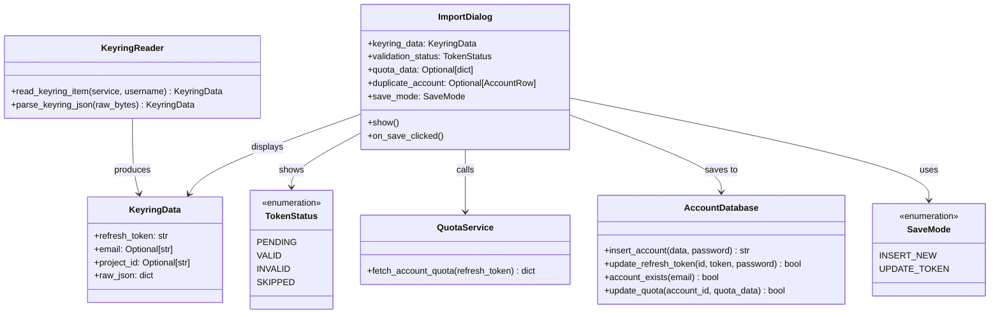

# PRD — Import Akun dari Antigravity CLI (Keyring)

| Field | Nilai |
| --- | --- |
| Status | **DRAF v0.1** — siap review; keputusan open ditandai §OQ |
| Pemilik | lemon-manis-22 |
| Project | `auth-login-management` |
| Tanggal | 2026-11-23 |
| Versi dokumen | 0.1 |
| Fitur | Import akun aktif dari GNOME Keyring → Form preview (edit) → Simpan ke DB |

> Dokumen ini dihasilkan dari sesi `grill-with-docs` (skill `grilling` + `domain-modeling`).
> Semua keputusan masih murah untuk diubah **sebelum implementasi**.

---

## 1. Ringkasan

Saat ini, menambah akun ke database dilakukan dengan menempelkan JSON secara manual ke `JsonInputWidget`.
Namun akun Antigravity CLI yang sedang aktif sudah tersimpan di **GNOME Keyring** (`service=gemini, username=antigravity`) — format JSON yang mengandung `refresh_token` dan `email`.

Fitur ini memungkinkan pengguna untuk:

1. **Ambil** data akun aktif langsung dari GNOME Keyring dengan satu klik.
2. **Lihat & edit** seluruh field di dialog form sebelum disimpan.
3. **Validasi** token secara live (exchange ke access token) dan optionally ambil data kuota.
4. **Simpan** ke database sebagai entri baru atau update akun yang sudah ada.

---

## 2. Masalah

| # | Masalah | Bukti |
| --- | --- | --- |
| M1 | Menambah akun aktif dari CLI membutuhkan copy-paste manual JSON keyring | User harus membuka `secret-tool` atau GNOME Keyring viewer |
| M2 | Refresh token di keyring bisa sudah dirotasi oleh Google; tidak ada cara cepat mengetahuinya | Token lama di DB bisa invalid diam-diam |
| M3 | Tidak ada validasi token saat input manual via JSON | Token salah baru ketahuan saat Apply |
| M4 | Tidak ada cara mengisi kuota secara otomatis saat menambah akun | Kolom kuota kosong setelah import |

---

## 3. Tujuan

- **G1** Pengguna dapat mengimpor akun aktif dari GNOME Keyring tanpa copy-paste manual.
- **G2** Form preview menampilkan seluruh field yang relevan dan memungkinkan pengguna mengedit sebelum menyimpan.
- **G3** Token divalidasi secara live; kuota diambil otomatis jika token valid.
- **G4** Duplikat email ditangani secara eksplisit — pengguna memilih: perbarui token atau tambah entri baru.
- **G5** Proses simpan menggunakan enkripsi aktif dari sesi (password tidak diminta ulang).

## 4. Non-Tujuan

- Tidak mengambil dari sumber lain selain GNOME Keyring (`service=gemini, username=antigravity`).
- Tidak mendukung import batch dari banyak akun keyring (hanya 1 akun aktif per keyring item).
- Tidak menghapus atau memodifikasi data di keyring.
- Tidak mendukung Windows/macOS (Secret Service hanya tersedia di Linux dengan GNOME Keyring atau KWallet).
- Tidak melakukan login/consent/OAuth baru — hanya membaca token yang sudah ada.
- Tidak menggantikan alur input JSON manual yang sudah ada.

---

## 5. Glosarium (Domain)

| Istilah | Definisi | Catatan |
| --- | --- | --- |
| **Keyring Item** | Satu entri di GNOME Keyring: `service=gemini, username=antigravity`. | Menyimpan JSON dengan `refresh_token` dan metadata. |
| **Import** | Alur: baca keyring → validasi token → fetch kuota → tampilkan form → simpan ke DB. | Berbeda dari "Apply" (dari DB ke target). |
| **Form Preview** | Dialog PyQt6 yang menampilkan semua field sebelum disimpan. | User bisa edit sebelum konfirmasi. |
| **Token Valid** | Refresh token berhasil ditukar menjadi access token via OAuth endpoint. | Bukan hanya format, harus dicek ke server. |
| **Duplikat Email** | Email dari keyring sudah ada di tabel `accounts`. | Harus ditangani eksplisit, bukan diam-diam. |
| **Upsert** | Update jika email sudah ada, insert jika belum. | Dipilih oleh pengguna, bukan otomatis. |
| **Enkripsi Aktif** | Password enkripsi yang sudah diinput di sesi ini (dari `SettingsDialog`). | Dipakai langsung tanpa prompt ulang. |

---

## 6. Keputusan Desain

| ID | Pertanyaan | Keputusan | Alasan | Biaya berubah |
| --- | --- | --- | --- | --- |
| D1 | Sumber data import | GNOME Keyring: `service=gemini, username=antigravity` | Ini satu-satunya tempat agy CLI menyimpan kredensial di Linux | Rendah |
| D2 | Data yang diambil | Email (dari JWT id_token) + refresh_token; kuota via API setelah validasi | Keyring hanya menyimpan token; email di-decode dari id_token | Rendah |
| D3 | Validasi token | Ya — exchange ke access_token sebelum form; status tampil di form | Token bisa sudah expired/rotated; lebih baik tahu sebelum simpan | Sedang |
| D4 | UI form | Dialog PyQt6 terpisah (mirip `SettingsDialog`) | Konsisten dengan pola UI yang sudah ada | Rendah |
| D5 | Entry point | Menu File → "Import dari Antigravity…" | Mudah ditemukan; tidak memperpadat toolbar | Rendah |
| D6 | Duplikat email | Peringatan di form + pilihan: Perbarui Token / Tambah Baru | Tidak diam-diam menimpa data; pengguna tetap kontrol | Sedang |
| D7 | Password enkripsi | Gunakan password sesi aktif; tidak prompt ulang | UX lebih mulus; password sudah divalidasi di awal sesi | Sedang |
| D8 | Kuota | Ambil live via `fetch_account_quota()` jika token valid; tampilkan di form; bisa diedit | Memanfaatkan infrastruktur kuota yang sudah ada | Rendah |
| D9 | Keyring hanya 1 akun | 1 item keyring = 1 akun aktif | Arsitektur agy CLI: 1 item per service+username | Rendah |

---

## 7. Alur Fungsional

```
User klik "Import dari Antigravity…"
        │
        ▼
[1] Baca Keyring (service=gemini, username=antigravity)
        │ gagal (tidak ada / D-Bus error)
        ├──────────────► Tampilkan error dialog "Keyring tidak tersedia"
        │ berhasil
        ▼
[2] Parse JSON keyring → ekstrak refresh_token + decode email dari id_token
        │
        ▼
[3] Validasi token (exchange refresh_token → access_token)
        │ invalid_grant / error
        ├──────────────► Status "Token tidak valid" di form (tetap tampilkan form)
        │ valid
        ▼
[4] Fetch kuota via fetch_account_quota() [async, timeout 15s]
        │ gagal
        ├──────────────► Kuota kosong di form; lanjut
        │ berhasil
        ▼
[5] Cek duplikat email di DB
        │ sudah ada
        ├──────────────► Set flag "Duplikat" + nama akun lama di form
        │ belum ada
        ▼
[6] Tampilkan ImportDialog (Form Preview)
        │ User edit field (kategori, project_id, dll)
        │ Duplikat? → Pilih: "Perbarui Token" atau "Tambah Baru"
        │ User klik "Simpan"
        ▼
[7] Simpan ke DB (insert atau update_refresh_token)
        │
        ▼
[8] Reload tabel akun di main window
```

---

## 8. Functional Requirements

### FR-01 Baca Keyring
- Sistem membaca item keyring `service=gemini, username=antigravity` via D-Bus (Secret Service API).
- Jika keyring tidak tersedia atau item tidak ditemukan: tampilkan `QMessageBox` dengan pesan yang jelas, hentikan alur.
- Jika keyring terkunci (locked): tampilkan pesan minta pengguna unlock dulu.

### FR-02 Parse Data dari Keyring
- Keyring item berformat JSON: parsing `refresh_token`.
- Email diekstrak dari `id_token` JWT (payload → klaim `email`) jika tersedia; jika tidak, field email kosong dan bisa diisi manual di form.
- Field lain yang mungkin tersedia di JSON keyring (mis. `project_id`) ditampilkan juga di form.

### FR-03 Validasi Token (Live)
- Lakukan exchange `refresh_token → access_token` via endpoint `https://oauth2.googleapis.com/token`.
- Status validasi ditampilkan di form: ✅ **Valid** / ❌ **Tidak Valid (pesan error)** / ⚠️ **Belum divalidasi**.
- Validasi dilakukan di background thread (`WorkerThread`) agar UI tidak freeze.
- Timeout 15 detik.

### FR-04 Fetch Kuota (Opsional)
- Jika token valid: panggil `fetch_account_quota(refresh_token)` secara otomatis.
- Hasil kuota ditampilkan di form (read-only, tapi bisa dikosongkan user).
- Jika fetch kuota gagal: form tetap tampil dengan kolom kuota kosong; tampilkan note "Kuota tidak berhasil diambil".

### FR-05 Form Preview (ImportDialog)
Form menampilkan dan memungkinkan edit field berikut:

| Field | Sumber | Edit? |
| --- | --- | --- |
| Email | Keyring (JWT decode) | Read-only (atau edit jika kosong) |
| Refresh Token | Keyring | Edit (teks tersembunyi + tombol reveal) |
| Status Token | Hasil validasi live | Read-only |
| Project ID | Keyring JSON / kosong | Edit |
| Kategori | Default kosong | Edit (dropdown/text) |
| Kuota: Gemini | API (jika valid) | Read-only di form |
| Kuota: Claude | API (jika valid) | Read-only di form |
| Reset Time | API (jika valid) | Read-only di form |
| Tindakan Duplikat | Muncul jika email ada di DB | Pilih: Perbarui Token / Tambah Baru |

### FR-06 Penanganan Duplikat Email
- Jika email sudah ada di DB: tampilkan banner peringatan di form dengan nama/ID akun yang sudah ada.
- Pengguna wajib memilih salah satu opsi (radio button atau dropdown):
  - **Perbarui Token** — panggil `db.update_refresh_token(existing_id, new_token)` + update kuota.
  - **Tambah sebagai Entri Baru** — insert dengan ID baru.
- Tombol "Simpan" dinonaktifkan sampai pilihan dipilih.

### FR-07 Simpan ke Database
- **Tambah Baru**: panggil path insert yang sudah ada di `AccountDatabase`, lengkap dengan enkripsi aktif dari sesi.
- **Perbarui Token**: panggil `update_refresh_token()` + update kolom kuota via method yang ada.
- Setelah simpan berhasil: tutup dialog, panggil `reload_accounts()` di `MainWindow`.

### FR-08 Entry Point UI
- Menu **File → "Import dari Antigravity…"** (`QAction` dengan ikon keyring/import).
- Shortcut opsional: `Ctrl+Shift+I`.
- Aksi disabled (greyed out) jika platform bukan Linux.

---

## 9. Non-Functional Requirements

| ID | Requirement |
| --- | --- |
| NF-01 | Validasi token dan fetch kuota dilakukan di `WorkerThread`; UI tidak boleh freeze. |
| NF-02 | Refresh token tidak pernah muncul di log, judul dialog, atau pesan error. |
| NF-03 | Jika `python3-dbus` tidak terinstall: menu item disabled dengan tooltip "Butuh python3-dbus". |
| NF-04 | Aksi batal di form tidak menyimpan apa pun dan tidak mengubah DB. |
| NF-05 | Dialog harus bisa dibuka kembali tanpa restart aplikasi. |

---

## 10. Struktur File Baru

```
src/
  ui/
    components/
      import_dialog.py          ← ImportDialog (Form Preview + logika penanganan duplikat)
  integrations/
    antigravity/
      keyring_reader.py         ← Fungsi baca + parse keyring item (pisah dari service.py)
```

> [!NOTE]
> `keyring_reader.py` adalah modul baru yang **hanya membaca** keyring — tidak menulis. Ini memisahkan concern dari `service.py` yang berfokus pada Apply.

---

## 11. Kriteria Penerimaan (AC)

| AC | Deskripsi | Cara Verifikasi |
| --- | --- | --- |
| AC-01 | Keyring ada & valid → form tampil dengan email dan token terisi | Manual: jalankan dengan keyring aktif |
| AC-02 | Keyring tidak ada → error dialog muncul, tidak crash | Manual: jalankan tanpa item keyring |
| AC-03 | Token valid → badge ✅ muncul di form + kuota terisi | Manual + mock token exchange |
| AC-04 | Token tidak valid → badge ❌ + pesan error; form tetap tampil | Mock `invalid_grant` |
| AC-05 | Email duplikat → banner muncul + pilihan Perbarui/Tambah Baru | DB dengan email yang sama |
| AC-06 | Simpan Tambah Baru → akun baru muncul di tabel | DB check setelah simpan |
| AC-07 | Simpan Perbarui Token → token lama diganti, baris yang ada diperbarui | DB check setelah simpan |
| AC-08 | Batal di form → DB tidak berubah | DB check setelah batal |
| AC-09 | Refresh token tidak tampil di log atau judul window | Review log manual |
| AC-10 | Platform bukan Linux → menu item disabled | Mock `sys.platform != 'linux'` |
| AC-11 | `python3-dbus` tidak ada → menu disabled dengan tooltip | Jalankan tanpa paket |

---

## 12. Pertanyaan Terbuka

| ID | Pertanyaan | Dampak |
| --- | --- | --- |
| OQ-1 | Apakah ada tombol "Validasi ulang" di form setelah pengguna mengedit refresh token secara manual? | UX minor |
| OQ-2 | Apakah kuota yang diambil langsung disimpan ke tabel `account_quotas` juga, atau hanya ke kolom JSON di `accounts`? | Schema minor |
| OQ-3 | Setelah "Perbarui Token", apakah kuota juga diperbarui otomatis di DB? | Scope |
| OQ-4 | Apakah perlu indikator loading/spinner saat validasi token dan fetch kuota berlangsung? | UX |

---

## 13. Domain Model



---

## 14. Risiko

| Risiko | Mitigasi |
| --- | --- |
| D-Bus tidak tersedia (Flatpak/sandbox) | Cek availability saat menu dibuka; disabled jika tidak tersedia |
| Keyring terkunci saat akses | Tampilkan pesan "Buka kunci keyring dulu" |
| Token sudah dirotasi Google → `invalid_grant` | Tampilkan di form; pengguna tetap bisa simpan (token mungkin masih bisa dipakai di beberapa konteks) |
| Kuota API timeout | Lanjut tanpa kuota; tidak bloking simpan |
| Keyring JSON format berubah di versi agy baru | Parse defensive — ambil field yang dikenal, sisanya diabaikan |

---

## 15. Definition of Done (v1.0)

- Seluruh FR-01 s.d. FR-08 dan AC-01 s.d. AC-11 terpenuhi.
- Unit test: `KeyringReader` (mock D-Bus), `ImportDialog` logika duplikat, path simpan DB.
- Smoke test manual: import dengan keyring aktif + token valid; import dengan token expired; import duplikat email (kedua pilihan).
- Tidak ada refresh token utuh di log atau dialog.
- Menu item nonaktif di non-Linux.
